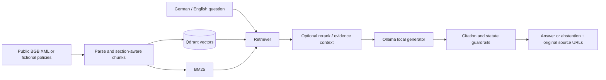

# German Legal RAG

**Local-first, bilingual research over German law — with inspectable source citations and reproducible retrieval experiments.**

[](https://github.com/somosing/german-legal-rag/actions/workflows/ci.yml)
[](LICENSE)
[](pyproject.toml)

German Legal RAG is an open-source **research and engineering demonstrator**, not a lawyer, legal-advice service, GDPR certification, or production security solution. It retrieves passages from the German Civil Code (BGB) or fictional demo policies, uses a local model to explain them in German or English, and exposes the cited source URLs for verification. It may abstain when evidence or citations are insufficient.

**Start here:** [Run the demo](#run-the-demo) · [How it works](#architecture) · [Evaluation](#evaluation-and-limitations) · [Roadmap](docs/OPEN_SOURCE_ROADMAP.md) · [Contribute](CONTRIBUTING.md)

## Two open-source directions

| Path | Intended audience | Current status |
| --- | --- | --- |
| **A · German Law Explorer** | Learners, researchers, engineers, and people navigating publicly available German legal text | **Prototype:** bilingual questions, BGB ingestion, official source links, local browser UI |
| **B · Private research workspace** | Individuals and teams comparing their own policies with public legal information | **Planned:** private document ingestion, isolation, deletion controls, and policy-versus-law comparison are **not yet implemented or security-audited** |

Both directions use the same evidence, retrieval, and evaluation architecture. The immediate goal is a **useful, inspectable repository**, not a subscription product.

## What works today

- **Offline-capable inference after model download:** Ollama for locally hosted embeddings and text generation.
- **Distinct retrieval paths:** BM25, Qdrant dense vectors, Reciprocal Rank Fusion hybrid, and optional cross-encoder reranking.
- **Section-aware indexing:** parent sections and child passages retain statute identity and original URLs.
- **Citation controls:** structured answer status, known source IDs, sentence-level citation checks, and fail-closed abstention for malformed or missing citations. These **do not establish factual entailment**.
- **Evaluation and audit tooling:** retrieval Hit@k/MRR/Recall; answer-status/citation-contract checks; export of claims for human support review.
- **Developer tooling:** Python CLI, local FastAPI/browser UI, `uv` environment, offline tests, Ruff, and GitHub Actions CI.

## Run the demo

Prerequisites: Linux/macOS with Python 3.11+, [uv](https://docs.astral.sh/uv/), and [Ollama](https://ollama.com/download). First-time model downloads need network access and enough disk space and memory; queries run locally afterward.

```bash
git clone https://github.com/somosing/german-legal-rag.git
cd german-legal-rag
uv sync --locked --extra dev
ollama pull embeddinggemma
ollama pull qwen3:4b-instruct
# If Ollama is not already running, launch it in another terminal:
# ollama serve

export RAG_STATE_DIR="$PWD/state-demo"
uv run legal-rag ingest --source demo
uv run legal-rag ask "Wie lange werden technische Testprotokolle gespeichert?"
uv run legal-rag ask "Who may access confidential project documents?" --mode hybrid
```

**The demo policies are fictional**, not statements of German law. Ingestion builds a local retrieval index. Local Qdrant storage is single-process: stop the web server before rebuilding the same index.

### Use the local browser UI

With the demo index available, launch:

```bash
export RAG_STATE_DIR="$PWD/state-demo"
uv run uvicorn legal_rag.api:app --host 127.0.0.1 --port 8000
```

Visit **http://127.0.0.1:8000/** (interface) or **http://127.0.0.1:8000/docs** (API reference). Do not expose this unauthenticated prototype to the public internet.

### Try public BGB provisions

Use **a separate state directory** from the fictional policies. The download obtains a publicly provided XML consolidation from [Gesetze im Internet](https://www.gesetze-im-internet.de/bgb/xml.zip); verify the current official legal wording and effective date yourself.

```bash
export RAG_STATE_DIR="$PWD/state-bgb"
uv run legal-rag ingest --source bgb --limit 150
uv run legal-rag ask "Wann beginnt die Rechtsfähigkeit eines Menschen?" --mode dense
```

Remove `--limit 150` to index the full available BGB corpus. This can require considerable time for local embedding; do not rebuild an existing index unless intended. A corpus preview is available using `uv run legal-rag ingest --source bgb --dry-run`.

## Architecture



Important files: `sources.py` and `chunking.py` handle ingestion; `retrieval.py` ranks passages; `generation.py` builds cited answers; `answer_evaluation.py` and `faithfulness.py` assess contracts and support-review workflows. [Detailed implementation plan](docs/IMPLEMENTATION_PLAN.md).

## Evaluation and limitations

**The tests in CI are offline software tests, not a measured legal-accuracy score.** The supplied BGB fixtures are small, authored, and not independently reviewed. A cited section may be irrelevant or a model may omit a crucial legal qualification despite satisfying the structural citation contract.

To reproduce the **full-BGB** answer-contract benchmark, first build an untruncated full BGB index and verify the snapshot/manifest documented in [Full-BGB benchmark](docs/FULL_BGB_BENCHMARK.md). Then:

```bash
export RAG_STATE_DIR="/path/to/your/full-bgb-index"
RAG_RETRY_ON_FAILURE=true uv run legal-rag eval-answers \
  --gold examples/bgb_full_answer_questions.json \
  --output reports/full_bgb_reproduction --mode dense
```

The 22-case full-BGB fixture checks answer/abstention and source identity, **not** legally verified factual correctness. Do not compare results from the fictional demo, the 100-section pilot, and full-BGB corpus as if they were the same experiment. The `dense_neighbors` retrieval mode and structured-claim repair work are experimental, not established defaults. Read [benchmark setup](docs/FULL_BGB_BENCHMARK.md), [retrieval comparisons](docs/BENCHMARKS.md), and [human-reviewed claim audit](docs/FAITHFULNESS_AUDIT.md).

## Quality checks

```bash
uv sync --locked --extra dev
uv run ruff check .
uv run pytest -q
```

Automated checks do not download models. Model-in-the-loop evaluation is a separate, local step.

## Contributing and scope

Issues, documentation corrections, test cases, bilingual UX feedback, and carefully scoped patches are welcome. Start with [CONTRIBUTING.md](CONTRIBUTING.md) and the [open-source roadmap](docs/OPEN_SOURCE_ROADMAP.md). For suspected vulnerabilities, follow [SECURITY.md](SECURITY.md); never publish confidential user documents or secrets in issues, fixtures, or test logs.

We prioritize **source traceability, reproducible measurements, honest limitations, and privacy** over flashy accuracy claims. Third-party laws, documents, dependencies, and model weights have their own licences/terms; the source code here is [MIT-licensed](LICENSE).

**Known gaps:** no independent legal validation, no source-effective-date guarantee, no authenticated multi-user document workspaces, no guaranteed factual entailment, and no production deployment/security review. See the [roadmap](docs/OPEN_SOURCE_ROADMAP.md).
