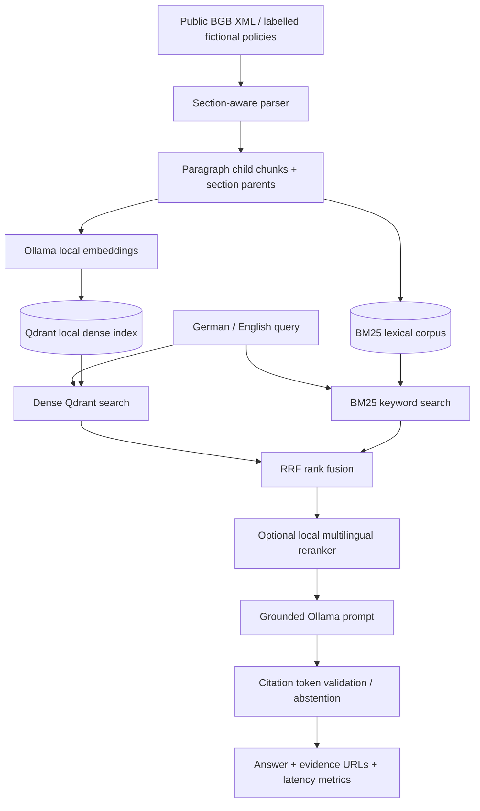

# German Legal RAG

**Local-first bilingual retrieval-augmented generation for German legal and compliance research.**

[](#quality-checks) · Python 3.11+ · MIT · Research demonstrator, **not legal advice**

> [!IMPORTANT]
> This is an **engineering prototype**, not a GDPR compliance certification, a production security review, or a guarantee against hallucinations. All demo policy texts are **fictional**. The official BGB ZIP download is a real public data source but consolidated online laws are *not the official promulgated version*. Check the version and current text before relying on it.

## Why this is different from a PDF chatbot

- Local-only LLM and embeddings via [Ollama](https://ollama.com/) (no API keys or remote inference service).
- **Hybrid retrieval**: Qdrant dense vectors and independently implemented BM25 candidate ranking, fused with **Reciprocal Rank Fusion**.
- Optional multilingual **BGE reranker** as a separate, measurable retrieval stage.
- **Parent-child section-aware chunking** of German law XML; section identities, URLs and parent context maintained.
- Answer citations `[S1]`, `[S2]` and a fail-closed response when citations are missing or unknown.
- Four-way retrieval ablation: **BM25-only vs dense-only vs equal-weight hybrid vs dense-3x hybrid**, Hit@k, MRR@k, Recall@k.
- Interactive local browser UI, offline tests, Ruff linting, GitHub Actions workflow, UV-managed installation and Dockerfile.
- Independent Python modules with no LangChain/LangGraph dependency in the critical path.

## Architecture



## Quickstart (Ubuntu/Linux)

Requires Python >=3.11, [uv](https://docs.astral.sh/uv/), and [Ollama](https://ollama.com/download). Tested pipeline logic offline; end-to-end model quality is **not** pre-certified.

```bash
# From this repository root:
uv sync --extra dev
ollama pull embeddinggemma
ollama pull qwen3:4b-instruct
# Start Ollama if your installation does not already run the service:
ollama serve
```

In a **second terminal**, from the repository root:

```bash
# Fictional compliance policy fixture (does not require Internet to fetch source)
uv run legal-rag ingest --source demo
uv run legal-rag ask "Wie lange werden technische Testprotokolle gespeichert?"
uv run legal-rag ask "Who may access confidential project documents?" --mode hybrid

# Local HTTP API with OpenAPI docs at http://127.0.0.1:8000/docs
uv run uvicorn legal_rag.api:app --host 127.0.0.1 --port 8000
# Open http://127.0.0.1:8000 for the local research UI, /docs for OpenAPI.
```

In a **third terminal**:

```bash
curl -s http://127.0.0.1:8000/health
curl -s -X POST http://127.0.0.1:8000/ask \
  -H 'Content-Type: application/json' \
  -d '{"query":"Welche Unterlagen erfordern rollenbasierte Zugriffskontrolle?","mode":"hybrid"}'
```

**Do not run ingestion and API simultaneously with local Qdrant**: its on-disk backend is single-process. Stop API, ingest, restart it. For multi-worker, concurrent or remote deployments, use dedicated Qdrant server (future work).

## Ingest actual German Civil Code (BGB)

```bash
# This downloads the official ZIP package and extracts its XML in memory:
uv run legal-rag ingest --source bgb --limit 150
uv run legal-rag ask "Was regelt § 1 BGB?"
```

Source: [Gesetze im Internet](https://www.gesetze-im-internet.de/bgb/xml.zip), supported by [GovData metadata](https://data.gov.de/suche/daten/gesetze-im-internet). **Re-indexing replaces the existing collection; do not evaluate BGB with the fictional `examples/demo_questions.json` benchmark.** The optional `--limit` makes the first run faster. Verify the version and URL for any provision before real use. Complex German legal tables/list structures require improved XML parsing before claiming comprehensive statutory coverage.

## Pilot evaluation on real BGB provisions

After `uv run legal-rag ingest --source bgb --limit 100`, run:

```bash
uv run legal-rag eval \
  --gold examples/bgb_pilot_questions.json \
  --output reports/bgb_pilot
cat reports/bgb_pilot/retrieval_report.md
```

The 30 handcrafted German/English questions refer to 10 official provisions (§§ 1, 2,
12, 13, 14, 26, 27, 43, 51 and 88). Labels use **official section URLs** and are
resolved to the local index's internal hashed IDs before scoring. A missing provision
fails loudly, preventing evaluation on the wrong corpus. These are author-designed,
non-blind, relatively easy retrieval questions, **not independent legal accuracy
certification**. The questions assess retrieval only, not generation or hallucinations.
For publication-quality evidence, add independent reviewers, more varied documents,
negative questions, and answer citation checks.

## Evaluation: no invented numbers

```bash
# Recreate the fictional demo index first (stop the API if running):
uv run legal-rag ingest --source demo
uv run legal-rag eval --gold examples/demo_questions.json --output reports
```

Produces `reports/retrieval_report.json` with per-query rankings and timing, plus `reports/retrieval_report.md` with Hit@k, MRR@k and Recall@k. Results are machine-generated only after execution and are `.gitignore`d until explicitly reviewed and committed. The included 30 questions are a **sanity suite**, not evidence of real legal performance. To compare retrieval modes, keep the same corpus, cutoff and embedding model. For serious CV claims, curate 30–100 validated legal queries including unanswerable, adversarial and bilingual cases, and run repeated benchmarks.

A future RAGAS module could calculate faithfulness and answer relevance with a **local configured judge**. It is not yet included: no metric here claims hallucination detection or GDPR compliance.

## Optional reranking

```bash
uv sync --extra rerank --extra dev
export RAG_RERANK=true
# On first use, sentence-transformers downloads BAAI/bge-reranker-v2-m3.
uv run legal-rag ask "Was besagt die Löschfrist?"
```

Reranking is disabled by default to minimize 6 GB GPU memory and dependency footprint. Benchmark reranking separately after retrieving and caching baseline results. Model source: [BAAI/bge-reranker-v2-m3](https://huggingface.co/BAAI/bge-reranker-v2-m3).

## Configuration

Copy `.env.example` to `.env` for reference, or set values with `export` (the application does not auto-load `.env`).

| Variable | Default | Purpose |
| --- | --- | --- |
| `OLLAMA_BASE_URL` | `http://127.0.0.1:11434` | Local model endpoint |
| `OLLAMA_LLM_MODEL` | `qwen3:4b-instruct` | Local generation model |
| `OLLAMA_EMBED_MODEL` | `embeddinggemma` | Dense vector model; changing it requires reindexing |
| `RAG_STATE_DIR` | `./state` | Local Qdrant and JSON persistence |
| `RAG_RERANK` | `false` | Enable optional local cross-encoder |
| `RAG_CANDIDATES` | `20` | Initial retrieval cutoff per modality |
| `RAG_FINAL_K` | `4` | Final passages included in answer context |

## Quality checks

The repository includes a committed `uv.lock` for reproducible dependency resolution. Run `uv sync --locked --extra dev` to install the tested dependency set.

```bash
uv sync --extra dev
uv run ruff check .
uv run pytest -q
```

CI performs **offline** unit tests without downloading any model. Indexing and LLM inference still require Ollama and the two model downloads.

## Docker (Linux example)

The model server is outside this container; run Ollama on the same **trusted** host. First index locally, then:

```bash
docker build -t german-legal-rag .
docker run --rm --network host \
  -e OLLAMA_BASE_URL=http://127.0.0.1:11434 \
  -e RAG_STATE_DIR=/app/state \
  -v "$PWD/state:/app/state" \
  german-legal-rag
```

The Dockerfile listens on `0.0.0.0` *inside the container*. In the Linux `--network host` example that can expose the API more broadly. **Do not run this Docker command on an untrusted network**; restrict firewall access or change the bind strategy. No authentication, authorization, TLS termination or multi-tenant isolation is implemented yet.

## Threat model and known limitations

| Threat / gap | Current mitigation | Needed before deployment |
| --- | --- | --- |
| External transmission of source data | Ollama inference configured to local endpoint, Qdrant local mode | Verify egress, model-download policy, telemetry, host isolation |
| Prompt injection via retrieved text | Mark evidence as untrusted and instruct model not to follow it | Adversarial evaluations, trust-boundary enforcement, further controls |
| Hallucinated legal claims | Require known citation **labels** and allow abstention | Sentence-level entailment verification, expert-labelled test sets |
| Outdated regulations | BGB public source and source URL | Effective-date metadata, official source versioning, periodic updates |
| Privacy / sensitive inputs | No query body persisted by application code | Access controls, retention/deletion, encryption, DPIA where appropriate |
| Concurrent requests | Local Qdrant persistence | External Qdrant, service concurrency tests |
| Incomplete parsing | XML section and paragraph extraction | Tables, cross-references, footnotes and structural validation |

**No production certification is implied.** Prompts, source citations, and local inference are *useful controls*, not proofs of legal accuracy or GDPR compliance.

## Next milestones

1. Add verified BGB/DSGVO legal test set with >=30 reviewer-checked queries, including unanswerable and adversarial inputs.
2. Add optional local faithfulness evaluator and cite support audit.
3. Publish measured quality baseline and p50/p95 latency benchmark on RTX 3060.
4. Add dedicated Qdrant server, roles/access control and secure document ingestion.
5. Add a simple interactive UI, ingestion progress and observable traces with redacted content.

## Attribution and licensing

The code in this repository is MIT licensed; third-party model weights, downloaded documents and dependencies have their **own licenses and terms**. Fictional demo policies are intentionally not descriptions of real law. BGB XML is published by the German federal legal-information service for reuse; verify government source metadata and publication dates. No personal or employer data is bundled.

## Guided development with Codex

Read [Implementation and learning plan](docs/IMPLEMENTATION_PLAN.md) and [six focused Codex tasks](docs/CODEX_TASKS.md). The `AGENTS.md` file defines the project's engineering constraints.

## Publish to GitHub

From the extracted project directory, after running `uv lock` and checking the code:

```bash
git init -b main
git add .
git commit -m "Initial German Legal RAG implementation"
# Log into the GitHub CLI if needed: gh auth login
gh repo create german-legal-rag --public --source=. --remote=origin --push
```

The publish command requires the GitHub CLI (`gh`) and your own logged-in account. Run it only after inspecting the repository content and choosing public/private visibility.

## Experiment: dense-weighted fusion (pilot benchmark measured)

The original `hybrid` mode uses equal-weight RRF (BM25 1x, dense 1x).
The `hybrid_dense3` mode tests a 3:1 dense:BM25 fusion weight. On the
30-question BGB pilot it did **not** improve Hit@4 over equal-weight hybrid
(0.900 for both); see `docs/BENCHMARKS.md`. The original baseline remains intact.

```bash
uv run pytest -q
uv run legal-rag eval --gold examples/demo_questions.json --output reports/rrf_ablation
uv run legal-rag ask "Wann ist ein Sicherheitsvorfall zu melden?" --mode hybrid_dense3
```

Compare both hybrid modes with dense-only in the evaluation report. Do not
select a production default based solely on eight fictional sections / 30
questions: assess on a larger, independently labelled legal dataset first.

## BGB pilot results and answer-status contract

A first 30-query BGB pilot (100 indexed legal sections) measured Hit@4 / MRR@4:

| Mode | Hit@4 | MRR@4 |
| --- | ---: | ---: |
| BM25 | 0.600 | 0.567 |
| Dense | **1.000** | **0.961** |
| Hybrid (equal RRF) | 0.900 | 0.764 |
| Hybrid (dense 3x) | 0.900 | 0.783 |

These are **pilot measurements**, not legal-answer accuracy or production claims. Dense is
now the default for `legal-rag ask` and `/ask` because it performed best in the pilot.
Other retrieval modes remain available for ablation. Re-run `legal-rag eval --gold
examples/bgb_pilot_questions.json --output reports/bgb_pilot` to reproduce local
results. The Markdown evaluation report lists individual missed questions.

Generation now requests a JSON-schema-constrained answer from Ollama with
`status: answered | insufficient_evidence`, answer text, and explicit source IDs.
The backend returns an abstention when status is insufficient, output is malformed,
or citations are inconsistent with the retrieved evidence. `metrics.abstention_reason`
explains the status. This fixes the old *textual refusal with abstained=false* behavior
in the structured contract; it **does not prove** cited claims are true. Validate
end-to-end behavior with your local Ollama model and build an independent answer
faithfulness dataset before claiming reliability.

## Answer contract evaluation (BGB pilot)

The retrieval benchmark tests whether the correct section was *found*. A separate
answer-level contract benchmark now tests whether the *generated output* follows the
structured status and citation rules:

```bash
# Keep the 100-section BGB index from the ingestion walkthrough.
# Stop any running Uvicorn service before starting this separate process.
uv run legal-rag eval-answers \
  --gold examples/bgb_answer_questions.json \
  --output reports/bgb_answers \
  --mode dense
cat reports/bgb_answers/answer_report.md
```

The 12-question curated pilot includes 6 in-corpus questions and 6 requests
for specific statutes **not indexed** in the first 100 sections. Before running,
the evaluator rejects a positive label whose expected source is not in the index,
or a negative label whose explicitly named statute *is* indexed. On a larger BGB
index, these negative fixtures must be replaced with new out-of-corpus questions.
The report includes per-question answer text, citation URLs, abstention status,
and p50/p95 latency, plus the following deterministic metrics:

- **Status accuracy**: did the API answer or abstain according to the supplied label?
- **Gold-section citation rate**: for positive questions, was an expected URL cited?
- **Negative abstention rate**: did it refuse requests about absent sections?
- **Citation consistency rate**: do the inline citation IDs match the returned source IDs?

**Crucial limitation:** source-ID validity is *not* factual faithfulness. A model
can cite a correct paragraph but still misstate its meaning. This evaluator does
not make legal accuracy, hallucination-free, or GDPR-compliance claims. The fixture
is a non-blind pilot and needs independent review. Generated text is saved to the
report, so use only public test questions unless retention/privacy has been reviewed.


## Faithfulness audit and corpus expansion (post-v0.1.0)

A new reviewer-annotated claim-support workflow complements the existing deterministic
citation/abstention benchmark. It exports answered claims alongside the cited
passages and requires reviewer labels, declared review provenance and exact quotations. No score
is invented for unreviewed claims.

```bash
# With the 100-section BGB index, run the original answer benchmark:
uv run legal-rag eval-answers --gold examples/bgb_answer_questions.json \
  --output reports/bgb_answers_review --mode dense
uv run legal-rag audit-export \
  --report reports/bgb_answers_review/answer_report.json \
  --output reports/faithfulness/review.json
# Edit review.json: declare review_method and mark supported / unsupported / unclear.
uv run legal-rag audit-score \
  --annotations reports/faithfulness/review.json \
  --output reports/faithfulness/score

# Preview full BGB coverage without overwriting the index:
uv run legal-rag ingest --source bgb --dry-run
```

Read [Human-reviewed faithfulness audit and expansion](docs/FAITHFULNESS_AUDIT.md)
for reviewer guidance, explicit limitations and safe full-corpus ingestion.
**Rebuild the benchmark fixture when the BGB index changes:** the original
negative examples depend on sections beyond the first 100 being absent.

## Citation and review limitations

Generation rejects answers containing sentence-like factual units without a source
citation and instructs the model to preserve legal preconditions. This is a
**structural guardrail**, not semantic verification; legal interpretations still
require reviewer assessment. Claim-review JSON has a `review_method` field so
AI-assisted preliminary audits cannot silently be presented as independent
human reviews. The field is self-declared and must be reported transparently.


## Experiment: opt-in bounded generation retry

The strict sentence-level citation validator may reject an answerable response,
reducing answer coverage. The optional retry performs **one more model call**
with the **same retrieved evidence** only when the initial response is malformed
or has a repairable structural citation failure. An explicit `insufficient_evidence`
decision is **never retried**, and an invented source ID fails closed immediately.
The second prompt requests a single, fully cited factual sentence. The final
response must still satisfy every citation check. This is a research experiment;
retry may increase latency and cannot establish factual faithfulness, so it is
**disabled by default**.

```bash
# Run the current baseline first (100-section index; stop the web server):
uv run legal-rag eval-answers --gold examples/bgb_answer_questions.json \
  --output reports/retry_baseline --mode dense
# Then run the opt-in retry ablation on the identical index:
RAG_RETRY_ON_FAILURE=true uv run legal-rag eval-answers \
  --gold examples/bgb_answer_questions.json \
  --output reports/retry_enabled --mode dense
```

Both reports include `generation_attempts`, `first_pass_failure`,
`first_pass_validation_error`, `final_validation_error`, and `abstention_reason`.
The validation details are structural codes (for example, `uncited_sentence`),
not raw text. Use these to distinguish model refusals from malformed citations.
Do not assume the retry improves support/faithfulness: manually audit claims
again and check that all six negative cases still abstain. The extra inference
call increases latency when triggered.
